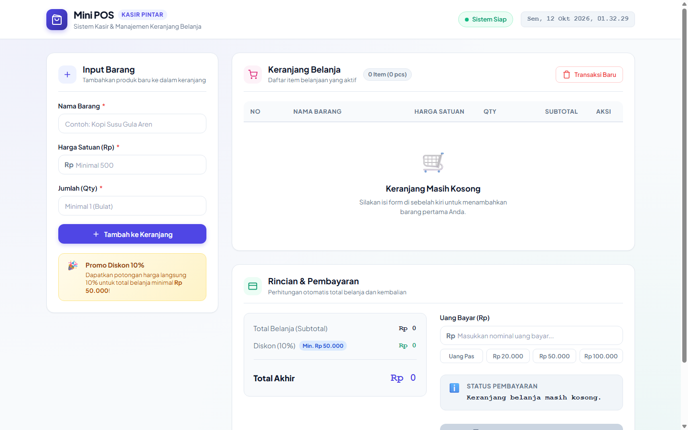
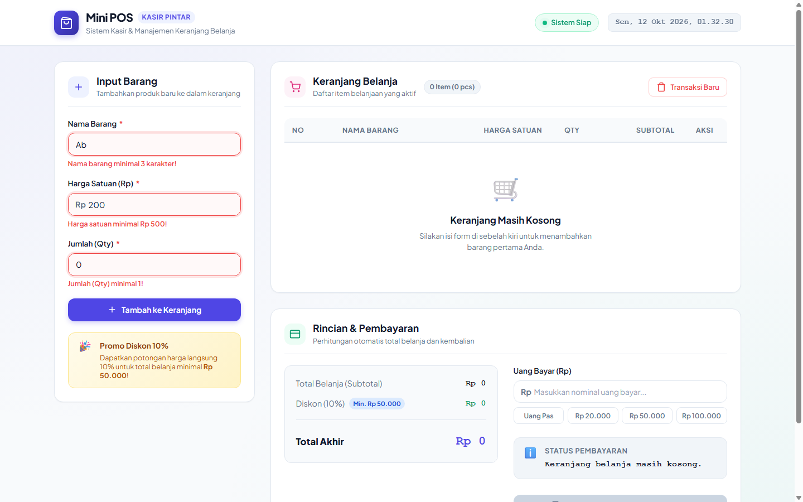
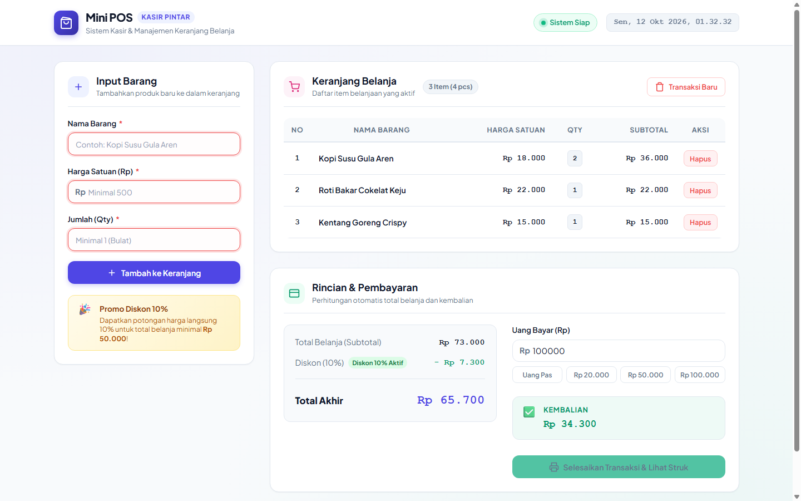
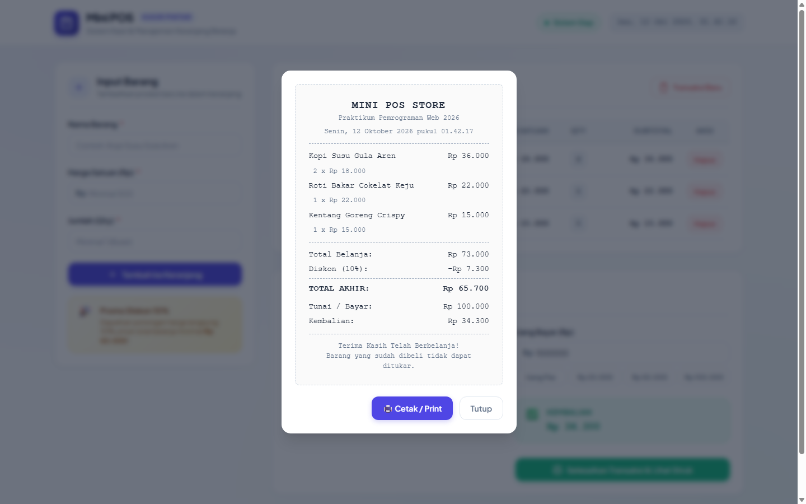

# Mini POS (Aplikasi Kasir & Keranjang Belanja Sederhana)
> **Praktikum Pemrograman Web - Pertemuan 1**  
> Implementasi Client-Side Web Application menggunakan Vanilla HTML, CSS, dan JavaScript.

---

## 👤 Identitas Praktikan
- **Nama Lengkap** : Ivan Nandira Mangunang
- **NIM**          : 123140094
- **Kelas**        : RA (Praktikum Pemrograman Web)

---

## 📖 Deskripsi Aplikasi

**Mini POS (Point of Sale)** adalah aplikasi kasir dan manajemen keranjang belanja berbasis web (*client-side*) yang dirancang untuk mensimulasikan pencatatan transaksi belanja secara *real-time*. 

### Tujuan Pembuatan:
1. Memahami manipulasi **Document Object Model (DOM)** menggunakan Vanilla JavaScript murni tanpa framework tambahan.
2. Mengimplementasikan **validasi form input** berlapis di sisi klien (*client-side form validation*) dengan umpan balik visual yang ramah pengguna.
3. Menerapkan algoritma **kalkulator keuangan otomatis** untuk akumulasi total belanja, diskon berjenjang, dan perhitungan kembalian pembayaran.
4. Menerapkan persistensi data berbasis peramban menggunakan **Web Storage API (`localStorage`)** dengan mekanisme serialisasi dan deserialisasi JSON (`JSON.stringify` & `JSON.parse`).

### Studi Kasus:
Studi kasus yang dipilih adalah sistem kasir gerai makanan dan minuman (*F&B / Mini Store*). Kasir dapat menginput nama produk, harga satuan, dan kuantitas barang, melihat akumulasi keranjang belanja, menerapkan diskon otomatis 10% jika mencapai syarat promo minimal belanja Rp 50.000, serta menghitung kembalian uang pelanggan dan mencetak struk transaksi.

---

## 🚀 Panduan Menjalankan Aplikasi

Aplikasi dibangun menggunakan teknologi standar web murni (HTML5, CSS3, dan Vanilla JavaScript ES6+), sehingga tidak memerlukan proses *build* atau *compile*.

### Opsi 1: Menggunakan Ekstensi VS Code "Live Server" (Direkomendasikan)
1. Buka folder `ivannandira_123140094_pertemuan1` di aplikasi **Visual Studio Code**.
2. Pastikan ekstensi **Live Server** (oleh *Ritwick Dey*) telah terpasang di VS Code.
3. Klik kanan pada file `index.html` di explorer file, lalu pilih **"Open with Live Server"** (atau klik tombol *Go Live* di status bar kanan bawah VS Code).
4. Browser akan terbuka secara otomatis pada alamat `http://127.0.0.1:5500/index.html`.

### Opsi 2: Membuka Langsung di Web Browser
1. Buka File Explorer di sistem operasi Anda.
2. Navigasikan ke direktori `d:\Praktikum Pengweb\ivannandira_123140094_pertemuan1`.
3. Klik dua kali (*double click*) pada file **`index.html`**, atau klik kanan $\rightarrow$ pilih **Open with** $\rightarrow$ pilih peramban web seperti Google Chrome, Microsoft Edge, atau Mozilla Firefox.

---

## ✅ Daftar Fitur & Spesifikasi

| Kategori | Fitur / Spesifikasi | Status | Keterangan |
| :--- | :--- | :---: | :--- |
| **Form Input & Validasi** | Input Nama Barang (Minimal 3 karakter) | `[✔]` | Validasi whitespace trim, pesan error teks merah di bawah input |
| | Input Harga Satuan (Angka positif $\ge 500$) | `[✔]` | Mencegah input non-angka, angka negatif, atau di bawah batas minimum |
| | Input Jumlah / Qty (Bilangan bulat $\ge 1$) | `[✔]` | Memvalidasi angka bulat integer positif |
| | Visual Feedback Error State | `[✔]` | Border merah, latar input highlight, dan pesan error animasi fade-in |
| | Auto Reset Form | `[✔]` | Form otomatis bersih setelah barang berhasil masuk ke keranjang |
| **Kalkulator Otomatis** | Perhitungan Subtotal Tiap Barang | `[✔]` | Dihitung otomatis: $\text{Harga Satuan} \times \text{Qty}$ |
| | Akumulasi Total Belanja (Subtotal) | `[✔]` | Menggunakan metode `Array.prototype.reduce()` secara reaktif |
| | Diskon Otomatis 10% | `[✔]` | Aktif otomatis jika Total Belanja $\ge \text{Rp } 50.000$ |
| | Perhitungan Total Akhir | `[✔]` | Total Belanja dikurangi potongan nominal diskon |
| | Input Uang Bayar & Quick Cash | `[✔]` | Input uang tunai dengan tombol cepat (*Uang Pas, 20k, 50k, 100k*) |
| | Deteksi Pembayaran Kurang | `[✔]` | Menampilkan status merah & menghitung nominal kekurangan |
| | Deteksi Kembalian / Pas | `[✔]` | Menampilkan nominal kembalian berwarna hijau |
| **Keranjang & Penyimpanan** | Tabel Keranjang Belanja Dinamis | `[✔]` | Kolom: No, Nama Barang, Harga Satuan, Qty, Subtotal, dan Aksi |
| | Hapus Item Individual | `[✔]` | Tombol hapus per baris dengan sinkronisasi kalkulasi otomatis |
| | Persistensi `localStorage` | `[✔]` | Data tidak hilang saat refresh browser (`JSON.stringify` & `JSON.parse`) |
| | Transaksi Baru / Reset All | `[✔]` | Dialog konfirmasi untuk mengosongkan keranjang & storage |
| **Fitur Ekstra / UI/UX** | Modal Struk Transaksi & Print | `[✔]` | Tampilan struk kasir (*thermal receipt*) siap cetak (`window.print`) |
| | Format Rupiah Standar Indonesia | `[✔]` | Menggunakan API `Intl.NumberFormat('id-ID')` |
| | Desain Responsif & Modern | `[✔]` | CSS Grid, Flexbox, dan tipografi Plus Jakarta Sans |
| | Jam Digital Header Realtime | `[✔]` | Tanggal dan jam kasir diperbarui setiap detik |

---

## 📸 Tangkapan Layar (Screenshots)

Berikut adalah tangkapan layar fungsionalitas aplikasi yang diambil pada resolusi desktop:

### 1. Tampilan Form Input Utama & Antarmuka Aplikasi
Antarmuka utama aplikasi yang lengkap, terdiri dari form input barang di sebelah kiri serta tabel keranjang belanja dan panel kalkulator di sebelah kanan:


### 2. Tampilan Saat Validasi Error Muncul
Pesan peringatan berwarna merah muncul secara presisi di bawah masing-masing kolom input saat kriteria validasi tidak terpenuhi (Nama $< 3$ karakter, Harga $< 500$, Qty $< 1$), dan item dicegah masuk ke keranjang belanja:


### 3. Tampilan Hasil Perhitungan Kalkulator & Tabel Riwayat Data
Tampilan aplikasi setelah beberapa item berhasil ditambahkan ke keranjang belanja, diskon otomatis 10% aktif karena total belanja $\ge \text{Rp } 50.000$, akumulasi total akhir, serta perhitungan otomatis uang kembalian pembayaran:


### 4. Tampilan Modal Struk Pembayaran (Fitur Ekstra)
Modal struk belanja (*thermal receipt*) yang menampilkan rincian produk, subtotal, potongan diskon, nominal bayar, serta kembalian yang siap untuk dicetak (*Print Preview*):


---

## 🧠 Penjelasan Teknis Singkat

Struktur kode JavaScript pada [script.js](script.js) dipisahkan secara modular ke dalam beberapa fungsi utama:

### 1. Penanganan Validasi Input Form
Logika validasi berada pada fungsi `validateForm()`, yang dieksekusi saat form disubmit (`submit` event):
- **Sanitasi Data**: Nilai teks dibersihkan dari spasi berlebih menggunakan `.trim()`.
- **Kondisi Nama Barang**: Dievaluasi dengan `nameVal.length >= 3`.
- **Kondisi Harga Satuan**: Dikonversi ke tipe numerik dan dicek apakah `!isNaN(priceNum)`, `priceNum > 0`, serta `priceNum >= 500`.
- **Kondisi Qty**: Dicek menggunakan `Number.isInteger(qtyNum)` dan `qtyNum >= 1`.
- **Visual Error Handling**: Fungsi pembantu `setError(group, errorEl, message)` menambahkan class CSS `.has-error` yang memberikan *outline/border* merah lembut dan memunculkan elemen `<small class="error-msg">`. Terdapat pula event listener `'input'` pada tiap kolom untuk menghapus status error secara *real-time* begitu pengguna mulai memperbaiki ketikannya.

### 2. Algoritma Kalkulator Keuangan & Pembayaran
Kalkulasi dipisahkan ke dalam fungsi `calculateTotals()` dan `calculatePayment()`:
- **Akumulasi Subtotal**:
  ```javascript
  const totalBelanja = cartItems.reduce((acc, item) => acc + item.subtotal, 0);
  ```
- **Diskon Berjenjang 10%**:
  ```javascript
  const isEligibleDiscount = totalBelanja >= 50000;
  const diskonNominal = isEligibleDiscount ? Math.round(totalBelanja * 0.10) : 0;
  const totalAkhir = totalBelanja - diskonNominal;
  ```
- **Logika Kembalian / Kekurangan Pembayaran**:
  Selisih dihitung dengan `uangBayar - totalAkhir`. Jika hasilnya negatif ($< 0$), aplikasi mendeteksi uang belum mencukupi dan menampilkan nominal kekurangannya dengan class `.status-insufficient`. Jika bernilai $\ge 0$, aplikasi menampilkan status `.status-success`, mengaktifkan tombol cetak struk, dan menghitung nominal kembalian.

### 3. Mekanisme Serialisasi & Deserialisasi LocalStorage
Data keranjang belanja dikelola dalam array JavaScript `cartItems`:
- **Penyimpanan (Serialisasi)**: Fungsi `saveCartToStorage()` mengubah array objek JavaScript menjadi representasi string JSON melalui:
  ```javascript
  localStorage.setItem('mini_pos_cart', JSON.stringify(cartItems));
  ```
- **Pembacaan (Deserialisasi)**: Fungsi `loadCartFromStorage()` membaca data string mentah dari browser dan mengembalikannya ke struktur array objek asli saat halaman dimuat:
  ```javascript
  const data = localStorage.getItem('mini_pos_cart');
  return data ? JSON.parse(data) : [];
  ```
- **Reset Transaksi**: Fungsi reset menghapus *key* terkait menggunakan `localStorage.removeItem('mini_pos_cart')` dan mengosongkan *state* array dalam memori sehingga antarmuka kembali ke kondisi awal secara bersih.

---

## 📁 Struktur Berkas Proyek

```plaintext
ivannandira_123140094_pertemuan1/
├── index.html              # Antarmuka utama dan struktur semantik HTML5
├── style.css               # Desain UI modern, responsif, dan styling validasi
├── script.js               # Logika validasi DOM, kalkulator, dan Web Storage
├── README.md               # Dokumentasi lengkap proyek tugas praktikum
└── screenshots/            # Tangkapan layar aplikasi untuk dokumentasi
    ├── 01_tampilan_utama.png
    ├── 02_validasi_error.png
    ├── 03_kalkulator_dan_keranjang.png
    └── 04_struk_transaksi.png
```
