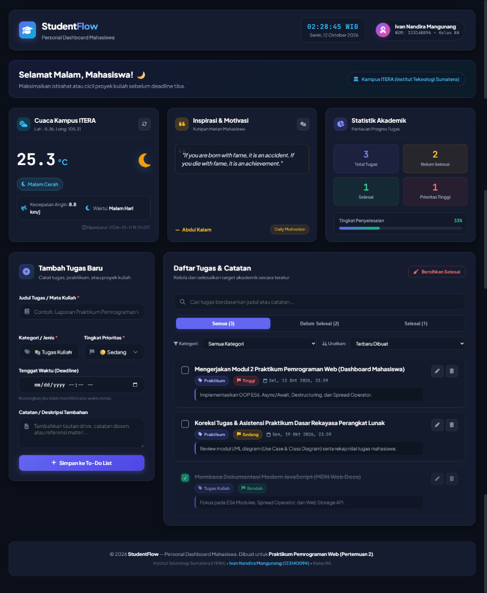

# StudentFlow — Personal Dashboard Mahasiswa
> **Praktikum Pemrograman Web - Pertemuan 2**  
> Implementasi Client-Side Web Application Modern menggunakan **HTML5, Vanilla CSS3, dan Modern JavaScript (ES6+)**.

---

## 👤 Identitas Praktikan
- **Nama Lengkap** : Ivan Nandira Mangunang
- **NIM**          : 123140094
- **Kelas**        : RA (Praktikum Pemrograman Web)
- **Program Studi**: Teknik Informatika, Institut Teknologi Sumatera (ITERA)

---

## 📖 Deskripsi Aplikasi

**StudentFlow** adalah aplikasi *Personal Productivity Dashboard* berbasis web (*client-side*) yang dirancang khusus untuk memenuhi kebutuhan mahasiswa dalam mengelola target akademik, memantau cuaca lokal kampus secara *real-time*, dan memperoleh kutipan inspirasi harian.

Aplikasi ini dibangun menggunakan arsitektur modern berorientasi objek (*Object-Oriented Programming* ES6) tanpa dependensi pustaka atau framework pihak ketiga (Vanilla HTML, CSS, dan JavaScript).

### Fitur Utama Aplikasi:
1. **To-Do List & Catatan Tugas Akademik**:
   - **Tambah Tugas**: Input nama tugas/mata kuliah, kategori (Praktikum, Tugas Kuliah, Kuis & Ujian, Proyek/Skripsi, Organisasi), prioritas (Rendah, Sedang, Tinggi), tenggat waktu (*deadline*), dan catatan tambahan.
   - **Edit Tugas**: Pembaruan data tugas secara interaktif melalui modal dialog terintegrasi.
   - **Hapus Tugas**: Menghapus catatan tugas yang tidak lagi diperlukan.
   - **Status Penyelesaian**: Menandai tugas selesai atau belum selesai (*toggle completion*).
   - **Filter & Pencarian Cepat**: Filter berdasarkan status (Semua, Belum Selesai, Selesai), filter kategori, pengurutan (*sorting* berdasarkan tanggal, deadline, atau prioritas), serta pencarian kata kunci secara *real-time*.
   - **Bersihkan Tugas Selesai**: Menghapus sekaligus semua tugas yang telah diselesaikan.
2. **Widget Cuaca Real-Time Kampus ITERA**:
   - Mengambil data cuaca lokal kampus Institut Teknologi Sumatera (Koordinat: *Latitude -5.36, Longitude 105.31*) secara langsung dari **API Open-Meteo**.
   - Menampilkan suhu terkini (°C), kondisi cuaca (WMO Weather Code diterjemahkan ke Bahasa Indonesia), kecepatan angin (km/j), indikator siang/malam, waktu pembaruan, serta tombol segarkan cuaca.
3. **Widget Quotes Harian (Inspirasi Mahasiswa)**:
   - Mengambil kutipan motivasi harian secara asinkron dari **API DummyJSON** (`https://dummyjson.com/quotes/random`).
   - Menampilkan teks kutipan motivasi, nama tokoh/penulis (*author*), serta tombol acak kutipan baru.
4. **Statistik Akademik & Progres**:
   - Memantau total tugas, jumlah tugas belum selesai, tugas selesai, tugas berprioritas tinggi (*urgent*), dan persentase penyelesaian tugas secara reaktif.
5. **Jam Digital & Sapaan Dinamis**:
   - Menampilkan waktu digital dan tanggal Indonesia secara *real-time* (WIB).
   - Menampilkan sapaan dinamis sesuai waktu (Pagi, Siang, Sore, Malam).
6. **Sistem Notifikasi Toast**:
   - Memberikan umpan balik visual (*toast feedback*) yang elegan untuk setiap aksi pengguna.

---

## 📸 Tangkapan Layar (Screenshot)

### Tampilan Aplikasi Desktop
Tampilan antarmuka penuh pada layar desktop/laptop dengan tata letak *CSS Grid* 2 kolom (formulir tambah tugas di sisi kiri dan daftar tugas terintegrasi di sisi kanan).



> *Catatan: File tangkapan layar tersimpan pada direktori proyek dengan nama `screenshot-desktop.png`.*

---

## 🚀 Panduan Menjalankan Aplikasi

Aplikasi dibangun menggunakan teknologi standar web murni (HTML5, CSS3, dan Vanilla JavaScript ES6+), sehingga tidak membutuhkan proses instalasi dependensi `node_modules` atau kompilasi *build step*.

### Opsi 1: Menggunakan Ekstensi VS Code "Live Server" (Direkomendasikan)
1. Buka folder `ivannandira_123140094_pertemuan2` pada **Visual Studio Code**.
2. Pastikan ekstensi **Live Server** (oleh *Ritwick Dey*) telah terpasang di VS Code.
3. Klik kanan pada file `index.html` di explorer file, lalu pilih **"Open with Live Server"** (atau klik tombol *Go Live* di status bar kanan bawah VS Code).
4. Peramban web akan otomatis terbuka pada alamat `http://127.0.0.1:5500/index.html`.

### Opsi 2: Membuka Langsung di Web Browser
1. Buka File Explorer di sistem operasi Anda.
2. Masuk ke direktori `d:\Praktikum Pengweb\ivannandira_123140094_pertemuan2`.
3. Klik dua kali (*double click*) pada file **`index.html`**, atau klik kanan $\rightarrow$ pilih **Open with** $\rightarrow$ pilih browser favorit Anda (Google Chrome, Microsoft Edge, atau Mozilla Firefox).

---

## 🛠️ Daftar Implementasi Fitur ES6+ (Persyaratan Teknis)

Berikut adalah rekapitulasi implementasi seluruh persyaratan teknis ES6+ beserta nomor baris spesifik pada file [`main.js`](./main.js):

| No | Persyaratan Teknis ES6+ | File Sumber | Lokasi Baris Kode | Deskripsi & Implementasi |
| :---: | :--- | :---: | :---: | :--- |
| **1** | **Deklarasi `let` dan `const` (Tanpa `var`)** | [`main.js`](./main.js) | Seluruh file (Contoh: L117, L137, L169, L182, L317, L446, L605, L714, L1173) | Seluruh deklarasi variabel dan konstanta menggunakan `let` dan `const` secara ketat. **Nol penggunaan kata kunci `var`** di seluruh kode. |
| **2** | **Arsitektur OOP ES6: `class TaskItem`** | [`main.js`](./main.js) | L26 – L108 | Class untuk memodelkan struktur data entitas tugas, memuat *constructor*, method `toggleStatus()`, `update()`, `isOverdue()`, `isDueToday()`, dan serialisasi `toJSON()`. |
| **3** | **Arsitektur OOP ES6: `class DashboardApp`** | [`main.js`](./main.js) | L214 – L1167 | Class utama untuk manajemen state aplikasi, inisialisasi DOM, integrasi `localStorage`, konsumsi API eksternal, dan penanganan event listeners. |
| **4** | **Arrow Functions ($\ge 3$ fungsi)** | [`main.js`](./main.js) | L117 – L132<br>L137 – L164<br>L169 – L177<br>L182 – L205<br>L317 – L335 | Mengimplementasikan fungsi panah (*Arrow Functions*):<br>1. `formatDateTimeIndonesia = (isoString) => {...}`<br>2. `getWeatherMeta = (code, isDay) => {...}`<br>3. `sanitizeHTML = (str) => {...}`<br>4. `getGreetingData = () => {...}`<br>5. `updateTime = () => {...}`<br>Serta callback pada fungsi array (`.map()`, `.filter()`, `.forEach()`). |
| **5** | **Template Literals (<code>`${...}`</code>)** | [`main.js`](./main.js) | L324<br>L449 – L454<br>L497 – L527<br>L584 – L594<br>L776 – L790<br>L796 – L885<br>L907 – L908<br>L1150 – L1153 | Digunakan untuk interpolasi string dinamis pada jam digital, rendering widget cuaca, kutipan motivasi, kartu item tugas To-Do List, status badge, statistik persentase, dan notifikasi toast ke DOM. |
| **6** | **Async/Await & Try/Catch (API Cuaca & Quotes)** | [`main.js`](./main.js) | L445 – L485 (Cuaca)<br>L537 – L578 (Quotes) | Mengambil data cuaca kampus ITERA dari API Open-Meteo (`fetchWeather`) dan kutipan acak dari API DummyJSON (`fetchQuote`) secara asinkron menggunakan `async/await` yang dibungkus blok `try/catch` dengan UI error fallback. |
| **7** | **Destructuring Assignment (Parameter & Objek)** | [`main.js`](./main.js) | L30 – L39<br>L60<br>L344<br>L465<br>L492 – L493<br>L557<br>L583<br>L604<br>L627<br>L798<br>L1078 | Menerapkan pemecahan struktur objek (*Destructuring*):<br>- **Destructuring Parameter**: Pada constructor `TaskItem`, method `update`, `addTask`, `editTask`, dan `renderQuote`.<br>- **Destructuring Objek API**: Mengekstrak `{ current_weather }` dari respons Open-Meteo serta `{ quote, author }` dari DummyJSON. |
| **8** | **Spread Operator (`...`) untuk State Immutability** | [`main.js`](./main.js) | L363, L434<br>L617<br>L635<br>L650<br>L667<br>L691<br>L714 | Mengelola array state `this.tasks` secara *immutable* tanpa mutasi langsung:<br>- Tambah tugas: `[newTask, ...this.tasks]`<br>- Edit tugas: `[...this.tasks.map(...)]`<br>- Hapus tugas: `[...this.tasks.filter(...)]`<br>- Toggle tugas: `[...this.tasks.map(...)]`<br>- Bersihkan tugas: `[...this.tasks.filter(...)]`<br>- Kloning array filter: `[...this.tasks]` |
| **9** | **Persistensi Data (`localStorage`)** | [`main.js`](./main.js) | L356 – L387 | Menyimpan dan memuat state To-Do List ke penyimpanan lokal peramban (`localStorage`) dengan serialisasi `JSON.stringify()` dan deserialisasi `JSON.parse()`. Dilengkapi mekanisme *initial seeding*. |

---

## 📂 Struktur Berkas Proyek

```plaintext
ivannandira_123140094_pertemuan2/
├── index.html        # Struktur semantik HTML5 antarmuka dashboard
├── style.css         # Desain tampilan UI, CSS Grid/Flexbox, dan tema modern dark glass
├── main.js           # Logika aplikasi (OOP ES6, State, Async/Await, Web Storage)
├── screenshot.png    # Tangkapan layar antarmuka aplikasi berjalan
└── README.md         # Dokumentasi lengkap proyek dan penilaian teknis
```

---

## 💡 Keunggulan UI/UX Tambahan
- **Desain Modern Dark-Glassmorphism**: Tampilan visual terinspirasi dari aplikasi produktivitas mutakhir (Linear, Notion) dengan aksen pencahayaan dinamis (*ambient glow*) dan palet warna HSL modern.
- **Tipografi Berkualitas**: Menggunakan perpaduan font Google `Plus Jakarta Sans` untuk hierarki antarmuka dan `JetBrains Mono` untuk jam digital serta indikator tanggal.
- **Micro-Animations & Transisi Halus**: Efek hover interaktif, animasi fade-in tugas baru, transisi status selesai, dan spinner animasi saat pengambilan data API berlangsung.
- **Desain Responsif**: Tata letak fleksibel yang menyesuaikan tampilan layar desktop, tablet, maupun telepon genggam (*mobile viewport*).
