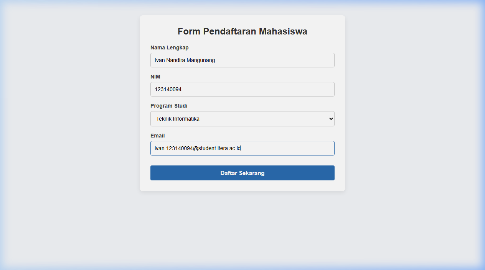
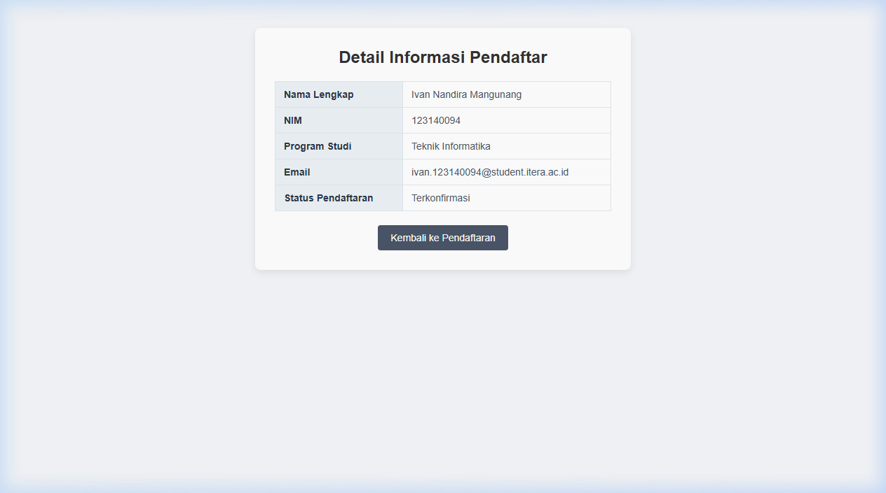

# Tugas Individu 3 — Pemrograman Web
> **Mata Kuliah**: Pemrograman Aplikasi Web RA  
> **Institusi**: Institut Teknologi Sumatera (ITERA)

---

## 👤 Identitas Mahasiswa
- **Nama Lengkap** : Ivan Nandira Mangunang
- **NIM**          : 123140094
- **Program Studi**: Teknik Informatika

---

## 📋 Deskripsi Tugas
Tugas ini bertujuan untuk membuat halaman web sederhana yang memenuhi kriteria:
1. **Dua Halaman Web**:
   - `index.html`: Halaman formulir pendaftaran mahasiswa menggunakan `method="GET"`.
   - `detail.html`: Halaman detail informasi pendaftar yang menampilkan data dummy.
2. **Desain Query String**:
   - Data dari form halaman pendaftaran dilempar ke halaman detail melalui query string URL (`detail.html?nama=...&nim=...&prodi=...&email=...`) secara otomatis saat tombol submit ditekan.
   - Halaman detail menangkap parameter URL tersebut menggunakan `URLSearchParams` dan menampilkannya secara dinamis pada tabel informasi pendaftar (dengan nilai default dummy jika diakses langsung tanpa query string).
3. **Desain CSS**:
   - Menggunakan minimal 3 jenis selector CSS.
   - Mengatur desain layout, box/card, tabel, dan form secara terstruktur, rapi, dan responsif.

---

## 📂 Struktur Berkas
```plaintext
task_3/
├── index.html            # Halaman formulir pendaftaran (Form method GET)
├── detail.html           # Halaman detail informasi pendaftar (Data dummy & tabel)
├── style.css             # Styling CSS untuk layout, box, form, dan tabel
├── screenshot-form.png   # Tangkapan layar formulir pendaftaran
├── screenshot-detail.png # Tangkapan layar detail informasi & query string
└── README.md             # Dokumentasi tugas individu 3
```

---

## 📸 Tangkapan Layar (Screenshot)

### 1. Halaman Formulir Pendaftaran (`index.html`)
Tampilan halaman pendaftaran dengan formulir yang telah diisi data mahasiswa:



### 2. Halaman Detail Informasi Pendaftar (`detail.html`)
Tampilan data pendaftar yang berhasil dilempar via **Query String** ke halaman detail:



---

## 🛠️ Rincian Implementasi Kriteria Tugas

### 1. Desain Query String (Halaman Pendaftaran)
Pada `index.html`, elemen `<form>` dikonfigurasi sebagai berikut:
```html
<form id="registration-form" action="detail.html" method="GET">
    <!-- input fields: nama, nim, prodi, email -->
    <button type="submit" class="btn-submit">Daftar Sekarang</button>
</form>
```
Saat tombol submit ditekan, browser secara native membuat query string pada URL tujuan:
```
detail.html?nama=Ivan+Nandira&nim=123140094&prodi=Teknik+Informatika&email=ivan%40mail.com
```

### 2. Halaman Detail Dummy (`detail.html`)
Menampilkan informasi pendaftar dalam komponen box card dan tabel (`<table>`) terstruktur, serta menyediakan tombol navigasi untuk kembali ke halaman form pendaftaran (`index.html`).

### 3. Implementasi Selector CSS (`style.css`)
Stylesheet mengimplementasikan lebih dari 3 jenis selector sesuai persyaratan tugas:
1. **Element Selector**: `body`, `h2`, `label`, `input`, `select` (mengatur gaya dasar elemen HTML).
2. **Class Selector**: `.card-box`, `.form-group`, `.btn-submit`, `.btn-back`, `.table-detail` (mengatur styling kartu kontainer, form layout, tombol, dan tabel).
3. **ID Selector**: `#registration-form` (mengatur display form pendaftaran).
4. *(Tambahan)* **Pseudo-class Selector**: `:focus` dan `:hover` (memberikan efek interaktif pada form dan tombol).

---

## 🚀 Cara Menjalankan
1. Buka folder proyek di **Visual Studio Code**.
2. Klik kanan pada file **`index.html`** di dalam folder `task_3`.
3. Pilih **"Open with Live Server"** (atau buka langsung file `index.html` melalui peramban web seperti Google Chrome / Microsoft Edge).
4. Isi form dan klik tombol **"Daftar Sekarang"** untuk melihat perpindahan halaman beserta query string di address bar browser.
